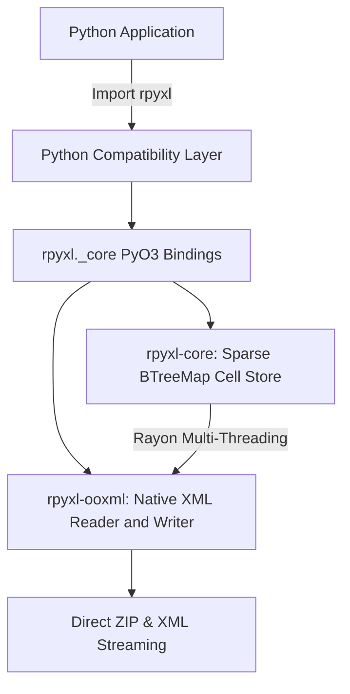

# RPyXL: A High-Performance, Rust-Powered Alternative to openpyxl

[](https://github.com/franckoj/rpyxl/actions/workflows/ci.yml)
[](LICENSE)
[](https://pypi.org/project/rpyxl/)
[](https://www.rust-lang.org/)
[](https://github.com/franckoj/rpyxl)

RPyXL is an experimental Python spreadsheet library with an **[openpyxl](https://foss.heptapod.net/openpyxl/openpyxl)-style API**, backed by a Rust core built with [PyO3](https://pyo3.rs/) and [Maturin](https://www.maturin.rs/).

**Compatibility is incomplete.** Version 0.2.0 adds tested text/temporal fidelity, file-like I/O, copy-on-write styles, rich-feature wrappers, and guarded native package preservation. Scoped tests do not establish production readiness, arbitrary lossless workbook preservation, or general drop-in compatibility. Unsupported reference-sensitive edits and cell payloads may be rejected rather than saved incorrectly. See the [remediation plan](docs/remediation_plan.md) for evidence and limitations.

---

## Performance Highlights

A targeted Windows/Python 3.14.3 comparison of the 0.2.0 implementation at `5883f7f` against openpyxl 3.1.5 used **20,000 rows x 20 columns**, fresh processes, and three repetitions with rotated execution order:

| Operation                               | openpyxl |   RPyXL | Speedup |
| --------------------------------------- | -------: | ------: | ------: |
| Styled writing                          |  17.45 s | 13.63 s |   1.28x |
| Insert/delete rows, including load/save |  11.75 s |  5.55 s |   2.12x |

These are workload-specific medians, not a universal performance guarantee. Styled-write incremental sampled memory remained higher than openpyxl (about 300 vs 195 MiB). Plain append/save also showed an unresolved 11-13% slowdown relative to an earlier rpyxl wheel in a separate control. See the [measurement evidence and remaining limitations](docs/remediation_plan.md).

The [future backend plan](docs/future_backend_plan.md) evaluates `rust_xlsxwriter` and Calamine separately; neither is a production backend in this release.

---

## Migration for Supported Workflows

For existing projects using `openpyxl`, the import can be changed as follows. Validate values, types, and required features before migrating:

```python
# Before
import openpyxl

# After
import rpyxl as openpyxl

# Validate this workflow against your original workbook and requirements.
wb = openpyxl.load_workbook("large_financials.xlsx", data_only=True)
ws = wb.active
print(ws["A1"].value)
```

See the full [Migration Guide](docs/migration_guide.md) for details.

---

## Quick Start

### 1. In-Memory Workbook Writing

```python
import rpyxl

wb = rpyxl.Workbook()
ws = wb.active
ws.title = "Sales"

ws["A1"] = "Employee"
ws["B1"] = "Revenue"
ws.append(["Alice", 15400.50])
ws.append(["Bob", 22900.75])

# Subscript access and coordinates
ws.cell(row=4, column=1, value="Charlie")
ws.cell(row=4, column=2, value=18300.00)

wb.save("sales_report.xlsx")
```

### 2. High-Throughput Streaming Writer (`write_only=True`)

Uses row-wise, disk-backed output for lower-memory exports; it does not support random cell access:

```python
import rpyxl
from datetime import datetime

wb = rpyxl.Workbook(write_only=True)
ws = wb.create_sheet("Transactions")

ws.append(["Transaction_ID", "Timestamp", "Amount", "Verified"])

for i in range(1, 100_001):
    ws.append([f"TX_{i:06d}", datetime.now(), i * 19.99, i % 2 == 0])

wb.save("transactions.xlsx")
```

### 3. Streaming Reader (`read_only=True`)

Iterates worksheet rows on demand. Accessing rich metadata can require additional workbook-wide loading:

```python
import rpyxl

with rpyxl.load_workbook("transactions.xlsx", read_only=True) as wb:
    ws = wb.active
    for row in ws.iter_rows(values_only=True):
        tx_id, ts, amount, verified = row
        # Process record
```

### 4. Advanced Slicing & Iteration

```python
# 2D tuple of Cell instances
grid = ws["A1:C10"]

# Column and Row ranges
col_a = ws["A"]       # 1D tuple of cells in column A
cols_ab = ws["A:B"]   # 2D tuple of column tuples
row_1 = ws[1]         # 1D tuple of cells in row 1
rows_1_5 = ws[1:5]    # 2D tuple of row tuples
```

---

## Installation

### From Pre-Built Wheels (ABI3)

```bash
pip install rpyxl
```

_Requires Python 3.9 or newer. ABI3 wheels target Linux (x86_64 and aarch64), macOS (Apple Silicon and Intel), and Windows x64. See CI and release artifacts for tested combinations._

### From Source

```bash
git clone https://github.com/franckoj/rpyxl.git
cd rpyxl
pip install maturin
maturin develop --release
```

---

## Documentation & Phase Reports

- [Release Changelog](CHANGELOG.md): Release history and 0.2.0 changes.
- [Future Backend Plan](docs/future_backend_plan.md): Staged writer and reader backend evaluation.
- [API Reference Manual](docs/api_reference.md): Detailed signatures and parameter reference.
- [openpyxl Migration Guide](docs/migration_guide.md): Drop-in patterns, edge cases, and best practices.
- [API Compatibility Matrix](docs/compatibility_matrix.md): Exhaustive openpyxl vs RPyXL feature matrix.
- [Development Changelog](docs/development_progress.md): Chronological engineering milestones.
- [Security Architecture & Threat Model](docs/security.md): Hardening against ZIP bombs, XXE, and malformed files.
- [Phase 1 Report](docs/reports/phase1_report.md): In-Memory Core & PyO3 Bindings.
- [Phase 2 Report](docs/reports/phase2_report.md): High-Performance XLSX Reader.
- [Phase 3 Report](docs/reports/phase3_report.md): High-Performance XLSX Writer.
- [Phase 4 Report](docs/reports/phase4_report.md): openpyxl Compatibility Layer.
- [Phase 5 Report](docs/reports/phase5_report.md): Multi-Scale Performance Optimizations.
- [Phase 6 Report](docs/reports/phase6_report.md): Packaging, Distribution & Documentation.
- [Phase 7 Report](docs/reports/phase7_report.md): Production Hardening & Security Resilience.
- [Phase 8 Report](docs/reports/phase8_report.md): Final Release Validation & Publishing.
- [Industry Benchmark Report](docs/reports/industry_benchmark_report.md): Comprehensive evaluation against openpyxl, xlsxwriter, calamine, and rust_xlsxwriter.

---

## Testing & Quality Gates

The entire test suite is containerized for deterministic reproduction:

```bash
# Build test container
docker build -t rpyxl-test .

# Run pure Rust unit and integration tests
docker run --rm -v $(pwd):/workspace rpyxl-test cargo test -p rpyxl-core -p rpyxl-ooxml

# Run formatting & Clippy linter
docker run --rm -v $(pwd):/workspace rpyxl-test cargo fmt --all -- --check
docker run --rm -v $(pwd):/workspace rpyxl-test cargo clippy --workspace --all-targets -- -D warnings

# Run Python compatibility, unit, and security tests
docker run --rm -v $(pwd):/workspace rpyxl-test bash -c "maturin develop && pytest tests/ -v"

# Run multi-scale benchmarks (1k, 10k, 100k, 500k cells)
docker run --rm -v $(pwd):/workspace rpyxl-test python benchmarks/run_multiscale.py
```

---

## Architecture Overview



- **`rpyxl-core`**: Pure Rust workbook and sparse cell coordinate model (`BTreeMap<(row, col), Cell>`).
- **`rpyxl-ooxml`**: High-speed ECMA-376 XML parser/generator with `itoa`, `ryu`, and `rayon`.
- **`rpyxl-python`**: Thread-safe PyO3 bindings with ABI3 multi-Python version support.
- **`python/rpyxl`**: Python public layer replicating openpyxl classes, styles, and exceptions.

---

## License

Licensed under either of:

- Apache License, Version 2.0 ([LICENSE-APACHE](LICENSE) or http://www.apache.org/licenses/LICENSE-2.0)
- MIT license ([LICENSE-MIT](LICENSE) or http://opensource.org/licenses/MIT)

at your option.
