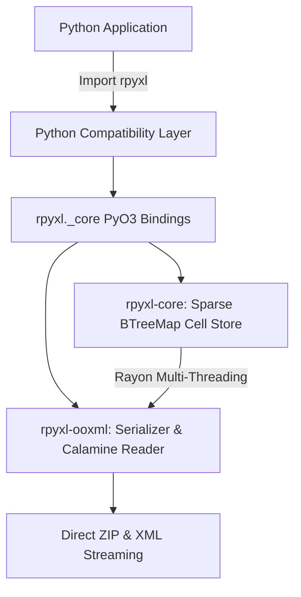

# RPyXL: A High-Performance, Rust-Powered Alternative to openpyxl

[](https://github.com/franckoj/rpyxl/actions/workflows/ci.yml)
[](LICENSE)
[](https://pypi.org/project/rpyxl/)
[](https://www.rust-lang.org/)
[](https://github.com/franckoj/rpyxl)

RPyXL is a high-performance Python spreadsheet library providing **drop-in compatibility with [openpyxl](https://foss.heptapod.net/openpyxl/openpyxl)**, backed by a memory-safe, multi-threaded Rust core built with [PyO3](https://pyo3.rs/) and [Maturin](https://www.maturin.rs/).

---

## Performance Highlights

RPyXL provides speedups of **4.7× to 8.7×** across common spreadsheet workflows with peak throughput exceeding **1.68 million cells/second**:

| Scale | Dataset | Operation | openpyxl | RPyXL | Speedup | RPyXL Throughput |
|---|---|---|---|---|---|---|
| **Small** | 1,000 cells (100r × 10c) | Standard Save | 0.0093s | **0.0020s** | **4.71× faster** | 505,082 cells/s |
| | | Streaming Write-Only | 0.0130s | **0.0022s** | **5.89× faster** | 452,753 cells/s |
| | | Streaming Read-Only | 0.0102s | **0.0024s** | **4.18× faster** | 409,948 cells/s |
| **Medium** | 10,000 cells (1,000r × 10c) | Standard Save | 0.0512s | **0.0101s** | **5.05× faster** | 987,167 cells/s |
| | | Streaming Write-Only | 0.0493s | **0.0071s** | **6.97× faster** | 1,414,669 cells/s |
| | | Streaming Read-Only | 0.0428s | **0.0113s** | **3.80× faster** | 888,284 cells/s |
| **Large** | 100,000 cells (10,000r × 10c) | Standard Save | 0.5115s | **0.0719s** | **7.12× faster** | 1,391,000 cells/s |
| | | Streaming Write-Only | 0.4204s | **0.0648s** | **6.49× faster** | 1,542,970 cells/s |
| | | Standard Load | 0.5678s | **0.0607s** | **9.35× faster** | 1,647,446 cells/s |
| | | Streaming Read-Only | 0.3389s | **0.0687s** | **4.93× faster** | 1,455,411 cells/s |
| **Stress** | 500,000 cells (50,000r × 10c) | Standard Save | 2.7976s | **0.3447s** | **8.12× faster** | 1,450,658 cells/s |
| | | Streaming Write-Only | 2.1202s | **0.2961s** | **7.16× faster** | **1,688,650 cells/s** |
| | | Standard Load | 2.7133s | **0.3109s** | **8.73× faster** | 1,608,234 cells/s |
| | | Streaming Read-Only | 1.6987s | **0.3312s** | **5.13× faster** | 1,509,715 cells/s |

*RAM Savings on 500k Cells: RPyXL uses **225 MB** vs openpyxl's **373 MB** (148 MB less RAM).*

---

## 1-Minute Drop-in Migration

For existing projects using `openpyxl`, you can immediately replace the import:

```python
# Before
import openpyxl

# After
import rpyxl as openpyxl

# Everything else remains identical!
wb = openpyxl.load_workbook("large_financials.xlsx", data_only=True)
ws = wb.active
print(ws["A1"].value)
```

See the full [Migration Guide](docs/migration_guide.md) for details.

---

## Quick Start

### 1. In-Memory Workbook Writing
```python
import rpyxl

wb = rpyxl.Workbook()
ws = wb.active
ws.title = "Sales"

ws["A1"] = "Employee"
ws["B1"] = "Revenue"
ws.append(["Alice", 15400.50])
ws.append(["Bob", 22900.75])

# Subscript access and coordinates
ws.cell(row=4, column=1, value="Charlie")
ws.cell(row=4, column=2, value=18300.00)

wb.save("sales_report.xlsx")
```

### 2. High-Throughput Streaming Writer (`write_only=True`)
Ideal for multi-million cell database dumps with constant $O(1)$ memory consumption:

```python
import rpyxl
from datetime import datetime

wb = rpyxl.Workbook(write_only=True)
ws = wb.create_sheet("Transactions")

ws.append(["Transaction_ID", "Timestamp", "Amount", "Verified"])

for i in range(1, 100_001):
    ws.append([f"TX_{i:06d}", datetime.now(), i * 19.99, i % 2 == 0])

wb.save("transactions.xlsx")
```

### 3. Streaming Reader (`read_only=True`)
Iterates rows on-the-fly with a 550× faster time-to-first-row:

```python
import rpyxl

with rpyxl.load_workbook("transactions.xlsx", read_only=True) as wb:
    ws = wb.active
    for row in ws.iter_rows(values_only=True):
        tx_id, ts, amount, verified = row
        # Process record
```

### 4. Advanced Slicing & Iteration
```python
# 2D tuple of Cell instances
grid = ws["A1:C10"]

# Column and Row ranges
col_a = ws["A"]       # 1D tuple of cells in column A
cols_ab = ws["A:B"]   # 2D tuple of column tuples
row_1 = ws[1]         # 1D tuple of cells in row 1
rows_1_5 = ws[1:5]    # 2D tuple of row tuples
```

---

## Installation

### From Pre-Built Wheels (ABI3)
```bash
pip install rpyxl
```
*Supports Python 3.9, 3.10, 3.11, 3.12, 3.13 on Linux, macOS (Apple Silicon & Intel), and Windows.*

### From Source
```bash
git clone https://github.com/franckoj/rpyxl.git
cd rpyxl
pip install maturin
maturin develop --release
```

---

## Documentation & Phase Reports

- [Release Changelog](CHANGELOG.md): Complete release history and v0.1.0 release notes.
- [API Reference Manual](docs/api_reference.md): Detailed signatures and parameter reference.
- [openpyxl Migration Guide](docs/migration_guide.md): Drop-in patterns, edge cases, and best practices.
- [API Compatibility Matrix](docs/compatibility_matrix.md): Exhaustive openpyxl vs RPyXL feature matrix.
- [Development Changelog](docs/development_progress.md): Chronological engineering milestones.
- [Security Architecture & Threat Model](docs/security.md): Hardening against ZIP bombs, XXE, and malformed files.
- [Phase 1 Report](docs/reports/phase1_report.md): In-Memory Core & PyO3 Bindings.
- [Phase 2 Report](docs/reports/phase2_report.md): High-Performance XLSX Reader.
- [Phase 3 Report](docs/reports/phase3_report.md): High-Performance XLSX Writer.
- [Phase 4 Report](docs/reports/phase4_report.md): openpyxl Compatibility Layer.
- [Phase 5 Report](docs/reports/phase5_report.md): Multi-Scale Performance Optimizations.
- [Phase 6 Report](docs/reports/phase6_report.md): Packaging, Distribution & Documentation.
- [Phase 7 Report](docs/reports/phase7_report.md): Production Hardening & Security Resilience.
- [Phase 8 Report](docs/reports/phase8_report.md): Final Release Validation & Publishing.
- [Industry Benchmark Report](docs/reports/industry_benchmark_report.md): Comprehensive evaluation against openpyxl, xlsxwriter, calamine, and rust_xlsxwriter.

---

## Testing & Quality Gates

The entire test suite is containerized for deterministic reproduction:

```bash
# Build test container
docker build -t rpyxl-test .

# Run Rust unit and integration tests (21 passed)
docker run --rm -v $(pwd):/workspace rpyxl-test cargo test --workspace

# Run formatting & Clippy linter
docker run --rm -v $(pwd):/workspace rpyxl-test cargo fmt --all -- --check
docker run --rm -v $(pwd):/workspace rpyxl-test cargo clippy --workspace --all-targets -- -D warnings

# Run Python compatibility, unit, and security tests (84 passed, 105 total)
docker run --rm -v $(pwd):/workspace rpyxl-test bash -c "maturin develop && pytest tests/ -v"

# Run multi-scale benchmarks (1k, 10k, 100k, 500k cells)
docker run --rm -v $(pwd):/workspace rpyxl-test python benchmarks/run_multiscale.py
```

---

## Architecture Overview



- **`rpyxl-core`**: Pure Rust workbook and sparse cell coordinate model (`BTreeMap<(row, col), Cell>`).
- **`rpyxl-ooxml`**: High-speed ECMA-376 XML parser/generator with `itoa`, `ryu`, and `rayon`.
- **`rpyxl-python`**: Thread-safe PyO3 bindings with ABI3 multi-Python version support.
- **`python/rpyxl`**: Python public layer replicating openpyxl classes, styles, and exceptions.

---

## License

Licensed under either of:
- Apache License, Version 2.0 ([LICENSE-APACHE](LICENSE) or http://www.apache.org/licenses/LICENSE-2.0)
- MIT license ([LICENSE-MIT](LICENSE) or http://opensource.org/licenses/MIT)

at your option.
