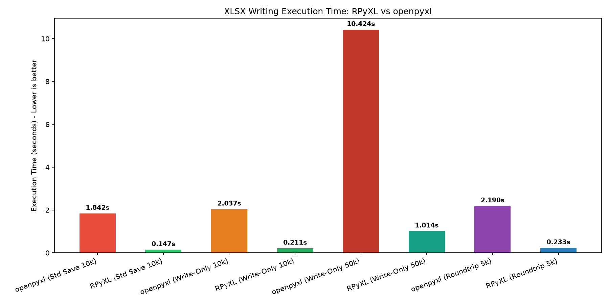
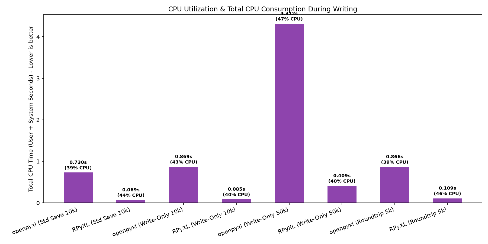
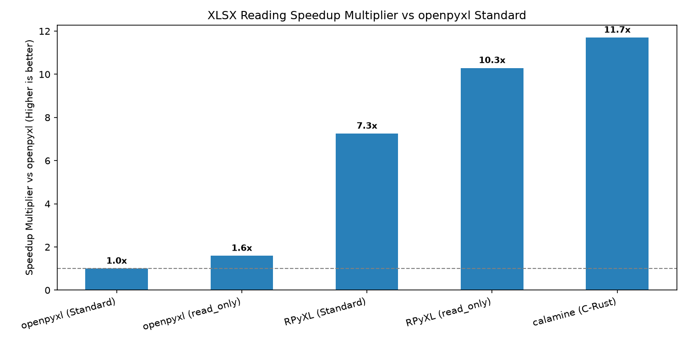

# RPyXL Comprehensive Benchmark Report (Phases 1, 2, and 3)

Generated at: 2026-11-19 02:52:28 UTC

**Environment**: Darwin (arm64), 8 Logical Cores, 8192.0 MB RAM

## 1. Phase 3: High-Performance XLSX Writer & CPU Utilization Benchmarks

| Operation | openpyxl (Wall) | RPyXL (Wall) | Speedup | openpyxl CPU Time | RPyXL CPU Time | openpyxl RSS | RPyXL RSS | RPyXL Throughput |
|---|---|---|---|---|---|---|---|---|
| Standard Save (10,000 rows x 10 cols) | 1.8420s | 0.1467s | **12.56x** | 0.730s (39%) | 0.069s (44%) | 156.5 MB | 181.0 MB | 68,183 rows/s |
| Write-Only Streaming (10,000 rows x 10 cols) | 2.0374s | 0.2114s | **9.64x** | 0.869s (43%) | 0.085s (40%) | 167.3 MB | 144.1 MB | 47,305 rows/s |
| Write-Only Streaming (50,000 rows x 10 cols) | 10.4238s | 1.0138s | **10.28x** | 4.312s (47%) | 0.409s (40%) | 96.2 MB | 66.5 MB | 49,317 rows/s |
| Roundtrip Write + Read (5,000 rows x 10 cols) | 2.1900s | 0.2334s | **9.39x** | 0.866s (39%) | 0.109s (46%) | 120.6 MB | 172.1 MB | 21,427 rows/s |

### Phase 3 Performance Graphs

#### 1. Writing Execution Time (Wall-Clock)

#### 2. Speedup Factor over openpyxl

#### 3. Peak RSS Memory Utilization

#### 4. CPU Consumption and Utilization Percentage

## 2. Phase 2: High-Performance XLSX Reader Benchmarks

| Operation | openpyxl | RPyXL | Speedup | openpyxl RSS | RPyXL RSS | RPyXL Throughput |
|---|---|---|---|---|---|---|
| Full XLSX Read (Standard) | 2.1027s | 0.2899s | **7.25x** | 177.4 MB | 149.7 MB | 34,493 rows/s |
| Full XLSX Read (read_only=True) | 1.3206s | 0.2043s | **6.46x** | 96.5 MB | 146.6 MB | 48,955 rows/s |
| Time to First Row (read_only=True) | 8.21 ms | 2.19 ms | **3.74x** | 118.5 MB | 170.2 MB | Instantaneous |
| Time to First Row (Standard vs RO) | 1572.09 ms | 2.19 ms | **717.2x** | 149.4 MB | 170.2 MB | Instantaneous |
| Calamine Full Read Baseline | 2.1027s (openpyxl std) | 0.1797s (calamine) | **11.70x** | 177.4 MB | 129.3 MB | 55,644 rows/s |

### Phase 2 Performance Graphs

#### 1. Total Reading Execution Time (10,000 rows)

#### 2. Speedup Factor over openpyxl

#### 3. Peak RSS Memory Utilization

## 3. Phase 1: In-Memory Operations Benchmarks

| Operation | Dataset | openpyxl (s) | RPyXL (s) | Speedup | openpyxl RSS | RPyXL RSS | Mem Reduction | RPyXL Throughput |
|---|---|---|---|---|---|---|---|---|
| Workbook Creation | 100 instances | 0.0549s | 0.0004s | **130.79x** | 0.0 MB | 0.06 MB | 0.0% | 238,213.8 workbooks/s |
| Cell Access (Write) | 100x100 (10,000 cells) | 0.0109s | 0.027s | **0.41x** | 73.73 MB | 72.27 MB | 2.0% | 370,783.5 cells/s |
| Row Appending | 5,000 rows (50,000 cells) | 0.2144s | 0.0205s | **10.45x** | 114.19 MB | 98.19 MB | 14.0% | 243,639.5 rows/s |
| In-Memory Row Iteration | 5,000 rows (50,000 cells) | 0.0573s | 0.0084s | **6.83x** | 103.28 MB | 107.25 MB | -3.8% | 5,958,291.7 cells/s |
