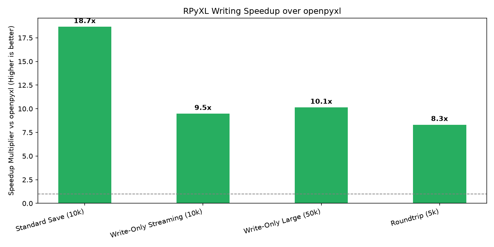
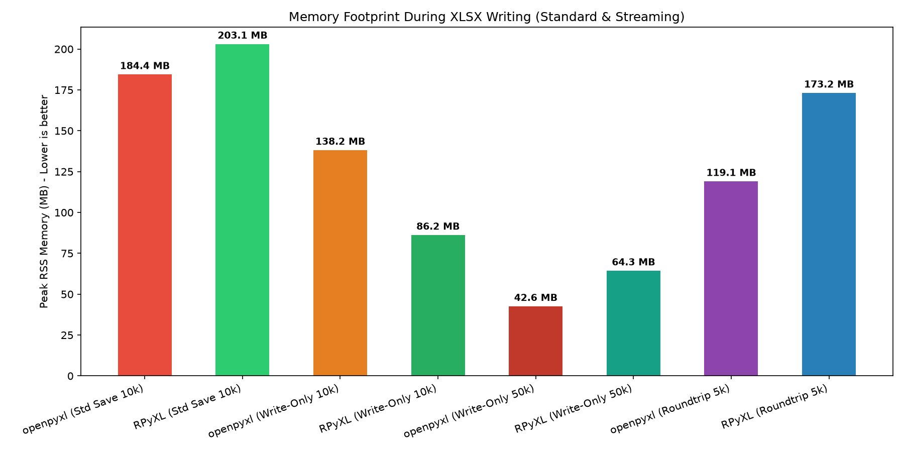
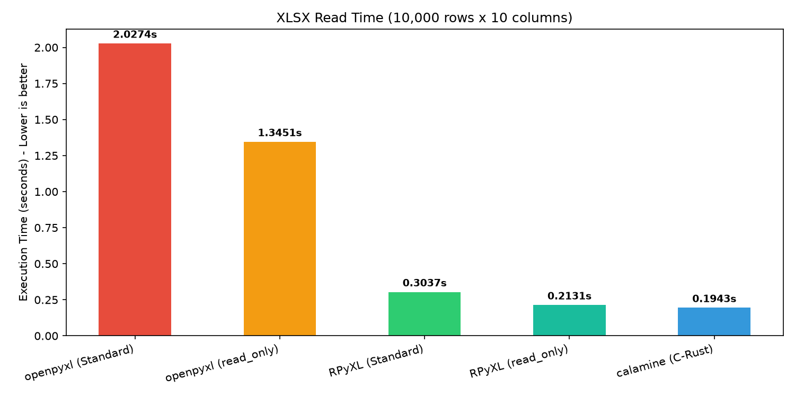
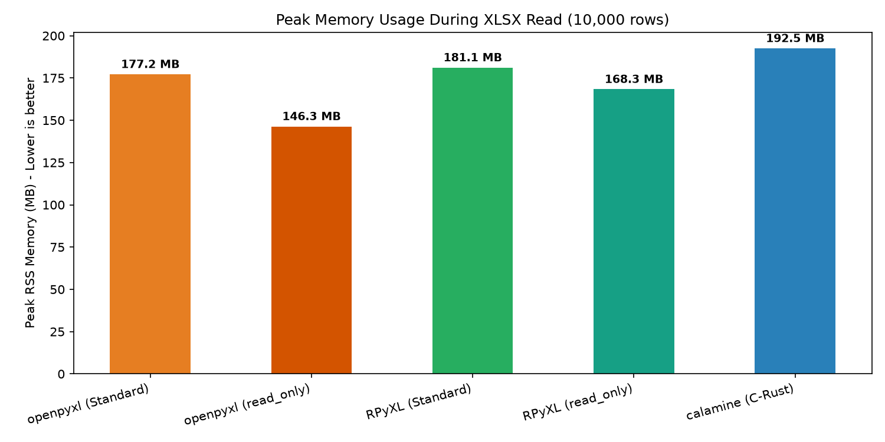

# RPyXL Comprehensive Benchmark Report (Phases 1, 2, and 3)

Generated at: 2026-11-17 19:25:16 UTC

**Environment**: Darwin (arm64), 8 Logical Cores, 8192.0 MB RAM

## 1. Phase 3: High-Performance XLSX Writer & CPU Utilization Benchmarks

| Operation | openpyxl (Wall) | RPyXL (Wall) | Speedup | openpyxl CPU Time | RPyXL CPU Time | openpyxl RSS | RPyXL RSS | RPyXL Throughput |
|---|---|---|---|---|---|---|---|---|
| Standard Save (10,000 rows x 10 cols) | 1.8849s | 0.1010s | **18.66x** | 0.696s (38%) | 0.071s (67%) | 184.4 MB | 203.1 MB | 98,981 rows/s |
| Write-Only Streaming (10,000 rows x 10 cols) | 1.9949s | 0.2103s | **9.49x** | 0.878s (48%) | 0.084s (36%) | 138.2 MB | 86.2 MB | 47,558 rows/s |
| Write-Only Streaming (50,000 rows x 10 cols) | 10.4780s | 1.0332s | **10.14x** | 4.010s (39%) | 0.381s (37%) | 42.6 MB | 64.3 MB | 48,394 rows/s |
| Roundtrip Write + Read (5,000 rows x 10 cols) | 2.3071s | 0.2774s | **8.32x** | 0.820s (36%) | 0.108s (38%) | 119.1 MB | 173.2 MB | 18,024 rows/s |

### Phase 3 Performance Graphs

#### 1. Writing Execution Time (Wall-Clock)

#### 2. Speedup Factor over openpyxl

#### 3. Peak RSS Memory Utilization

#### 4. CPU Consumption and Utilization Percentage

## 2. Phase 2: High-Performance XLSX Reader Benchmarks

| Operation | openpyxl | RPyXL | Speedup | openpyxl RSS | RPyXL RSS | RPyXL Throughput |
|---|---|---|---|---|---|---|
| Full XLSX Read (Standard) | 2.0274s | 0.3037s | **6.68x** | 177.2 MB | 181.1 MB | 32,932 rows/s |
| Full XLSX Read (read_only=True) | 1.3451s | 0.2131s | **6.31x** | 146.3 MB | 168.3 MB | 46,919 rows/s |
| Time to First Row (read_only=True) | 10.09 ms | 3.29 ms | **3.07x** | 158.9 MB | 187.9 MB | Instantaneous |
| Time to First Row (Standard vs RO) | 1825.83 ms | 3.29 ms | **554.7x** | 200.8 MB | 187.9 MB | Instantaneous |
| Calamine Full Read Baseline | 2.0274s (openpyxl std) | 0.1943s (calamine) | **10.44x** | 177.2 MB | 192.5 MB | 51,479 rows/s |

### Phase 2 Performance Graphs

#### 1. Total Reading Execution Time (10,000 rows)

#### 2. Speedup Factor over openpyxl

#### 3. Peak RSS Memory Utilization

## 3. Phase 1: In-Memory Operations Benchmarks

| Operation | Dataset | openpyxl (s) | RPyXL (s) | Speedup | openpyxl RSS | RPyXL RSS | Mem Reduction | RPyXL Throughput |
|---|---|---|---|---|---|---|---|---|
| Workbook Creation | 100 instances | 0.0687s | 0.0005s | **129.41x** | 0.62 MB | 0.05 MB | 91.9% | 188,250.2 workbooks/s |
| Cell Access (Write) | 100x100 (10,000 cells) | 0.0094s | 0.0153s | **0.61x** | 80.41 MB | 78.78 MB | 2.0% | 655,066.5 cells/s |
| Row Appending | 5,000 rows (50,000 cells) | 0.1977s | 0.0254s | **7.78x** | 115.92 MB | 104.83 MB | 9.6% | 196,640.1 rows/s |
| In-Memory Row Iteration | 5,000 rows (50,000 cells) | 0.0636s | 0.0085s | **7.47x** | 113.89 MB | 108.97 MB | 4.3% | 5,870,870.2 cells/s |
